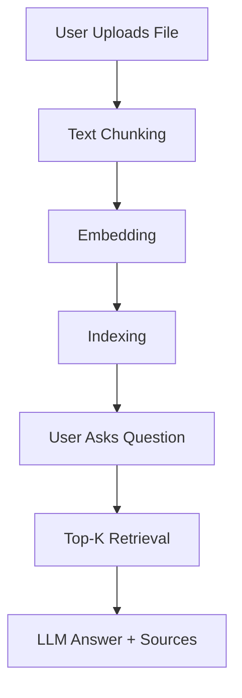

# 🧠 Agentic RAG Chatbot

[](https://www.python.org/)
[]()

A multi-format, document-based **Retrieval-Augmented Generation (RAG)** chatbot enhanced with a modular **agentic architecture** in which agents talk to each other through **MCP-style structured messages** (sender, receiver, type, trace ID, payload). Developed to demonstrate proficiency in real-world AI tooling, scalable system design, and intelligent QA workflows for enterprise use cases.

---

## 📌 Problem Statement

Organizations deal with large volumes of unstructured documents. Extracting knowledge from such formats often requires contextual understanding, not just keyword search. This system enables natural language querying over documents of varied formats using LLMs, retrieval systems, and modular agents.

---

## 🚀 Key Features

✅ Upload PDFs, DOCX, PPTX, TXT, CSV, Markdown  
✅ Agent-based architecture: Ingestion, Retrieval, and LLM Response  
✅ FAISS-based similarity search  
✅ Real-time Q&A using Streamlit chatbot UI  
✅ Displays **retrieved chunks** for transparency  
✅ Modular, testable, and extensible codebase  
✅ Answers generated by Llama 3 via the Groq API

---

## 🧰 Tech Stack

| Layer           | Technology                              |
|-----------------|------------------------------------------|
| UI              | `Streamlit`                              |
| Backend         | `Python` (OOP-based modular agents)      |
| Embeddings      | `SentenceTransformers (MiniLM-L6-v2)`    |
| Vector Database | `FAISS`                                  |
| LLM APIs        | `Groq` (Llama 3)                         |
| Document Parsing| `PyMuPDF`, `python-docx`, `python-pptx`  |

---

## 📊 Workflow



## 📁 Project Structure

```text
agentic_rag_chatbot/
│
├── 🧠 agents/               → Core logic for:
│     ├── ingestion_agent.py       (Document chunking)
│     ├── retrieval_agent.py       (Similarity search using FAISS)
│     └── llm_response_agent.py    (Response generation using LLMs)
│
├── 📂 data/                → Stores uploaded files
├── 📂 db/                  → FAISS index and pickled vector store
├── 🖥️ ui/                  → Streamlit frontend for user interaction
├── 🧰 utils/               → Utility scripts (MCP-style messages, parsers)
│
├── 📄 .env                 → Environment variables (API keys etc.)
├── 📦 requirements.txt     → List of Python dependencies
├── 📘 README.md            → Project documentation
└── 🚫 .gitignore           → Files/directories to be ignored by Git

```

## ⚙️ Getting Started

```bash
git clone https://github.com/AmanDataverse/Agentic_RAG_chatbot.git
cd Agentic_RAG_chatbot
pip install -r requirements.txt

# add your Groq API key (free at console.groq.com)
echo "GROQ_API_KEY=your_key_here" > .env

streamlit run ui/app.py
```

Upload one or more documents in the app, then ask questions about them in the chat.

## 🎬 Demo Video

🎥 [Click here to watch the demo video](media/Demo_Agentic_RAG_CHATBOT.mp4)

## 📑 Presentation

📊 [Click here to download the presentation](presentation/Agentic_RAG_Chatbot_Presentation.pptx)
